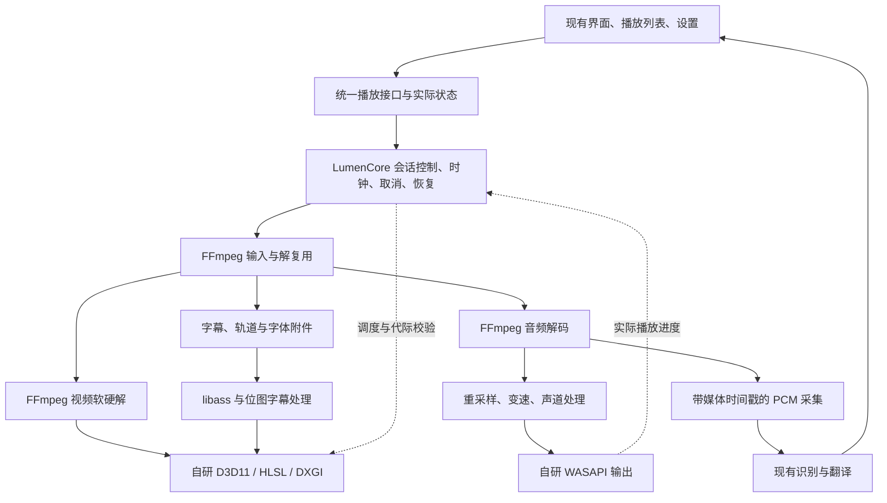

# LumenPlayer 独立播放内核可行性与架构提案

状态：Proposed，供评估；尚未实施或确定替换正式内核。核查日期：2026-10-30。比较基线：本地 LumenPlayer 2.2.3。

可以在不依赖 mpv 的情况下建立自主播放内核，并以当前 LumenPlayer 的功能集合为目标逐步达到可比能力。推荐保留 FFmpeg 与 libass，由项目自行拥有播放状态、调度、音画同步、视频渲染、音频输出和实时字幕采集。最有把握的超越方向是本项目的交互、字幕联动、可观测性及特定硬件上的效率；全面超过 mpv 的格式覆盖、画质算法、驱动兼容和异常媒体容错，不能由“重写”本身保证。

“最多保留 FFmpeg 和 libass”按两个直接依赖项目理解，允许其经过审核的必要间接依赖和 Windows 系统 API。若要求除此之外完全没有第三方代码，libass 自身的字体依赖以及部分 FFmpeg 协议/解码组件也要裁剪或替换，必须重新评估兼容范围。此限制针对播放内核；现有语音识别和翻译模型的运行库属于另一条依赖链。

本轮核对了源码、正式 EXE 版本资源、发行清单、既有验收记录及官方资料，没有运行新内核、重新测量性能或重跑完整播放矩阵。下述能力均区分“现有实现”“已存验收记录”“拟实现目标”。

## 当前基线与可复用资产

正式程序 `dist/LumenPlayer.exe` 的 FileVersion/ProductVersion 均为 2.2.3，根发行清单同为 2.2.3。最新发布记录说明：本次版本调整单击/双击输入契约，解码、模型与渲染沿用此前实现；该版本记录了 51 项点击专项、223 项播放控件回归及 1,613 项完整播放断言。上述是已存记录，本次没有重新执行。实体 HDR、功放、完整公网协议及长片性能等仍须按各自版本和设备证据判断。[2.2.3 发布记录](D:/LumenPlayer/docs/click-fix-2.2.3-2026-10-30.md)

| 现有部分 | 核查事实 | 对自主内核的意义 |
|---|---|---|
| 主播放链路 | libmpv + FFmpeg + libplacebo + libass；gpu-next/D3D11 与 WASAPI | 需要替换的是一整套调度、呈现和恢复行为，不只是一个解码函数 |
| Backend 与状态结构 | 已有 Backend、CoreOptions、CorePlaybackState、CoreStatus；高频时间线与轨道列表快照已分开 | 保留业务层和状态语义，补齐统一的高级控制接口，避免推倒 UI |
| 主内核耦合 | Player 的轨道、字幕、A/B、逐帧、取消和状态等仍大量 dynamic_cast 到 MpvBackend | 首先消除这些控制路径对具体实现的依赖，否则接上新 Backend 后许多功能仍不可用 |
| FFmpeg 兼容链路 | 已有解复用、软硬解、时间戳、定位、取消、重采样等代码 | 可复用底层经验与部分代码，但并非主内核的等价替代 |
| 硬解帧传递 | FfmpegReader::VideoSample 对 D3D11 帧调用 av_hwframe_transfer_data，读回 CPU | 新路径可研究 GPU 内传递；这是相对于现有兼容路径的机会，不能据此断言超过 mpv 主路径 |
| 变速 | SwBackend::SetRate 明确拒绝非 1.0 倍速，缺少保持音高处理 | 必须补齐音频时间伸缩、滤镜排空及时间轴映射 |
| 轨道与字幕 | FfmpegReader 初次选取最佳音视频轨；完整切轨与字幕策略集中在主内核 | 需建设轨道选择、默认/强制字幕、语言偏好、外挂字幕、附件字体及位图字幕管理 |
| 自有视频桥 | video_bridge.cpp 实际调用 libplacebo 渲染、色彩处理与 mpv GLSL hook 解析 | 若依赖上限为 FFmpeg/libass，该桥的实现也需要替换 |
| 实时字幕 | 主播放连接内提取选中音轨 PCM，并有暂停、seek、切轨和取消语义 | 自主调度有利于将这些语义变成内核原生接口，替代维护 mpv 内部补丁 |

源码定位：[Backend](D:/LumenPlayer/src/player.h:19)、[控制耦合](D:/LumenPlayer/src/player.cpp:1365)、[状态结构](D:/LumenPlayer/src/playback_types.h:8)、[硬解读回](D:/LumenPlayer/src/ffmpeg.cpp:360)、[兼容路径变速](D:/LumenPlayer/src/player.cpp:869)、[渲染实现](D:/LumenPlayer/src/video_bridge.cpp:133)、[GLSL 解析](D:/LumenPlayer/src/video_bridge.cpp:200)。

## 路线比较

| 路线 | 与约束的关系 | 达到当前能力的判断 | 主要代价 |
|---|---|---|---|
| 自研调度 + FFmpeg + libass + 自研 D3D11/WASAPI | 符合两个直接依赖的目标 | 推荐；常用能力可逐项对齐，广泛兼容仍需长期测试 | 接管 mpv 的播放语义，并重做 libplacebo 负责的渲染部分 |
| 自研调度 + FFmpeg + libass + libplacebo | 超出“最多 FFmpeg/libass”的限制 | 工程量较小，但仅作为比较方案 | 继续依赖成熟渲染库，无法满足严格依赖上限 |
| 自研调度 + Media Foundation/MFT + libass，无 FFmpeg | 仅保留系统媒体组件和 libass | 可用于明确限定编码/容器/设备的播放器；不适合直接承诺当前通用能力 | 编解码可用性随系统、驱动、扩展而变；容器、网络、软解兜底仍有缺口 |
| 容器、协议、软解码器、字幕和渲染全部自研 | 可以追求完全独立 | 理论可行；广泛覆盖不适合作为当前项目的一次普通升级 | 多专业团队多年建设和持续维护；不是简单增加几个解码器 |

Windows 的 MFT 需要枚举并验证实际可用变换；支持的 API 存在不代表目标机器拥有对应解码器。[MFTEnumEx 官方说明](https://learn.microsoft.com/en-us/windows/win32/api/mfapi/nf-mfapi-mftenumex) 微软同时列出 HEVC、AV1 等扩展，以及 Windows 11 24H2 起 AC-3 不再默认随系统提供的情况，因此不能把系统能力视为固定的 FFmpeg 等价集合。[Windows 编解码组件说明](https://support.microsoft.com/en-us/windows/apps/windowsmediaplayer/troubleshoot-windows-media-player-errors)

## 推荐结构

采用进程内模块和明确接口即可，首阶段不建立通用插件平台。控制请求由会话线程串行化；输入、解码、音频输出和视频呈现按阻塞特性隔离。各队列同时限制媒体时长与内存字节数。旧正式程序作为隔离的外部比较基线，新内核最终发行物不包含 mpv，也不在内部静默回退到 mpv。

FFmpeg 的库边界建议为 libavformat、libavcodec、libavutil、libswresample，按实际需要使用 libavfilter 与 libswscale。先保证能力，再用构建配置裁减不需要的组件；不要将调用 ffmpeg.exe/ffplay 子进程作为播放内核。

## 能力对齐与风险

| 能力 | 需要实现的内容 | 验收重点 / 风险 |
|---|---|---|
| 本地文件与软硬解 | 一次输入会话，解复用包分发，B 帧重排，PTS、时基及中途格式变化；保留软件解码兜底 | H.264、HEVC 10-bit、AV1、VP9 等实际启用编码，4:2:0/4:2:2/4:4:4，旋转与宽高比；设备不支持时必须能回退或清晰失败 |
| GPU 呈现 | 尽可能让 FFmpeg 硬解与渲染共享同一 D3D11 设备；管理纹理、子资源、同步和引用寿命 | 优先 GPU 内传递；不可采样的解码表面允许 GPU 拷贝，CPU 读回作为明示兜底；不能承诺所有格式永远零拷贝 |
| 音画同步 | 音频正常工作时以实际消费进度驱动主时钟；处理设备缓冲延迟、时钟漂移、VFR 与显示节奏；纯视频单独时钟 | 长片漂移、音频断续、后台/最小化、暂停恢复、24/25/30/60fps 在不同刷新率上的呈现 |
| 定位、逐帧与循环 | 最终 seek 生效；代际更新；包、帧、DSP、WASAPI、字幕队列一致失效；关键帧前滚解码与目标丢帧 | seek 完成报告实际恢复位置；长 GOP 倒退一帧不能当成简单时间相减；EOF 必须排空解码器和输出 |
| 音频输出 | WASAPI 共享/独占、设备枚举、声道映射、重采样、丢失后重建、可取消退出 | 指定与实际设备/格式分开报告；多声道、设备拔插、独占失败及恢复 |
| 0.1–12× 保持音高 | 起步可用 FFmpeg atempo 串联；管理变速延迟、排空、动态切换与媒体时间映射 | 对齐实际时长、非静音、音高和听感；支持参数范围不等于等同当前音质 |
| 压缩直通 | 独立的编码包输出与封装路径；与 PCM DSP 分支明确互斥 | 保留现有“字幕采集或非 1× 时转 PCM”的策略；无需为首版引入并行解码直通。实体 HDMI 功放验证不能由封装测试代替 |
| ASS/SSA 与普通字幕 | FFmpeg 获取/转换字幕，libass 负责 ASS 排版光栅化，项目负责字体附件、选择与合成；位图字幕独立处理 | 卡拉 OK、定位、动画、字体、缩放、强制字幕、延迟、PGS 等；libass 不替代位图字幕解码 |
| 实时字幕 | 从同一输入、选中音轨获取 PCM，静音前采集，建立原始媒体时间与输出播放时间映射 | 采集受实际播放进度约束，避免解码预读导致提前识别；暂停不投递；seek/切轨丢弃旧代数据；取消注册等待在途回调退出 |
| 网络 | FFmpeg 协议实现加自有超时、取消、队列水位、重连和缓存策略 | HLS/DASH、UDP/SRT、延迟音轨、时间戳断续、签名 URL 和断流；HLS 可以需要多个 HTTP 请求，“同一会话”指识别不另开一条完整播放连接 |
| SDR/HDR 与缩放 | 自研 YUV/RGB、范围、色度位置、传递函数、色域、缩放、PQ/HLG、tone mapping、峰值平滑、抖动与字幕亮度 | 10-bit 交换链不等于完整 HDR；跨显示器、系统 HDR 状态改变、参考白和高光细节都要实测 |
| 外部 GLSL / hook | 自建 hook 调度、纹理语义及 GLSL 接入，或将明确列出的预设迁移成 HLSL | 固定预设画面相似不等于兼容所有 mpv shader；任意脚本兼容是独立高成本子项目 |
| 故障与诊断 | 输入取消、队列唤醒、设备重建、软硬解恢复、分阶段错误和实际输出信息 | 恶意/损坏输入的长度与分配上限、超时、模糊测试；日志去除 URL 凭据/签名，不能让失败日志泄露网络认证 |

FFmpeg 的 D3D11VA API 提供设备与硬件帧上下文，但资源所有权、锁与渲染侧可访问性仍由集成者正确处理；本方案的低拷贝路径是设计目标。[FFmpeg D3D11VA 接口](https://ffmpeg.org/doxygen/trunk/hwcontext__d3d11va_8h_source.html)

atempo 官方文档给出的单级范围为 0.5–100，并指出大于 2 的处理会跳过部分样本；使用各级 0.5–2 的级联可以覆盖项目的 0.1–12× 范围，但音质与总延迟必须单独比较。[FFmpeg 音频滤镜文档源码](https://raw.githubusercontent.com/FFmpeg/FFmpeg/master/doc/filters.texi)

Windows 原生支持 D3D11/DXGI 的 Advanced Color 路径，可采用 FP16/scRGB 或满足条件的 RGB10/HDR10 输出；显示能力与状态改变必须反映到呈现配置中。自研色调映射、缩放等算法仍是本项目的工作。[Microsoft Advanced Color](https://learn.microsoft.com/en-us/windows/win32/direct3darticles/high-dynamic-range) 使用 flip model 及呈现统计可以支持帧调度，但采用 API 本身不能证明优于当前主内核。[DXGI flip model](https://learn.microsoft.com/en-us/windows/win32/direct3ddxgi/dxgi-flip-model)

## ADR-独立内核-01：保留 FFmpeg 与 libass

**状态：Proposed。**

**背景：** 希望自主控制播放行为，同时保留当前大量容器、编码、网络、软硬解和字幕能力。

**建议决策：** 自主实现播放内核，保留经过固定版本和配置审核的 FFmpeg/libass；不依赖 mpv/libplacebo。复用现有界面、设置、模型和字幕业务。FFmpeg 版本更新应通过锁定构建与回归验收，不能直接把查询到的 trunk API 当作本地 ABI。

**收益：** 输入、缓冲、调度与 PCM 采集归项目统一管理；消除 mpv 内部 PCM 补丁维护点；保留成熟编解码覆盖和字幕排版。

**代价：** 项目接管原有播放核心的边界条件及渲染兼容维护；依赖数量减少不自动减少总代码、内存、功耗或维护工作。

**替代方案：** 纯 Media Foundation 适合有限媒体集合，无法直接承诺完整覆盖；保留 libplacebo 工期更小，但不符合严格上限；全面自研编解码不作为当前升级路线。

libass 的现行构建明确依赖 FreeType、FriBidi、HarfBuzz 等。直接依赖与传递依赖必须分开定义；“只留下两个库名称”不是实际依赖审计。[libass 构建配置](https://raw.githubusercontent.com/libass/libass/master/meson.build)

## ADR-独立内核-02：先建立统一播放契约和代际语义

**状态：Proposed。**

**背景：** 现有高级能力通过具体 MpvBackend 调用，直接新增 Backend 无法继承全部功能；实时字幕和连续定位对时间轴一致性敏感。

**建议决策：** 基于现有 Backend 与 CoreStatus 增补状态、轨道、字幕、取消、逐帧、循环和 PCM 接口；异步操作包含请求代际和完成事件，能力不可用时返回明确原因。用单会话控制线程协调有界队列。实际硬解、音频格式、HDR、回退原因作为状态返回。

**收益：** 业务层与后端解除具体实现耦合，能够复用行为测试；定位完成使用内核确认的实际恢复时间，字幕无需猜测。

**代价：** 需要迁移测试里对 mpv 名称、日志、具体命令和属性的假设；新接口不宜成为无边界的大型插件框架。

**失败策略：** 关闭/取消必须中断输入和唤醒等待队列；seek、切轨、重开产生新代际，旧代所有回调丢弃；GPU/音频设备恢复完成后重新建立时钟，不沿用失效设备的播放位置。

## ADR-独立内核-03：自研 D3D11 渲染，单独管理 shader 兼容承诺

**状态：Proposed。**

**背景：** 当前画质桥实际上依赖 libplacebo；删除 DLL 会直接丢失渲染能力。外部 mpv GLSL hook 还有语言、纹理与执行阶段语义。

**建议决策：** 首选已有经验较多的 D3D11/DXGI，按实测需要再评估 D3D12。自研 HLSL 固定渲染管线，优先对齐当前实际使用的缩放和色彩设置；预置 shader 可在构建期编译。将“预设效果迁移”与“任意 mpv GLSL hook 兼容”列成不同交付项。

**收益：** 最终可以移除 libplacebo 及不再需要的 shader 编译/转换运行依赖；算法与时机可由项目调整。

**代价：** 画质和驱动兼容成为长期工作；HLSL 预设不能冒充通用 GLSL 兼容。若保留任意 GLSL 导入是完整替换的硬要求，需要自建/接入符合依赖政策的 GLSL 处理链，并延后全量替换验收。

## 何处有机会超过现版本

| 目标 | 可能获益的原因 | 必须收集的证据 |
|---|---|---|
| 定位和取消响应 | 控制请求、队列失效和实际恢复事件一体化 | 相同媒体、相同硬解策略下，连续定位与网络取消的 p50/p95、最坏值和错误恢复成功率 |
| 实时字幕联动 | 原生 PCM 接口、选中音轨、媒体时间与代际由同一内核负责 | 播放加识别加翻译的联合负载；输入 PCM、识别文本、屏幕字幕及 seek 后时间线全部有证据 |
| 特定硬件效率 | 固定 Windows 目标、限制队列、减少不必要的 CPU/GPU 转换 | 新进程 CPU 时间、私有提交、工作集、GPU decode/3D/copy 占用、掉帧及稳定态功耗 |
| 故障体验 | 更清晰的能力探测、回退原因和设备恢复契约 | 驱动不支持、拔插、停滞输入、损坏流、变更显示设备的真实结果 |
| 特定场景画质 | 可以为具体显示器、动画/低分辨率等场景调整算法 | 同画面、同输出色域与亮度的主观/客观比较，实体 HDR 测量；锐化更强不能直接等同更准确 |

应以当前正式 mpv 主路径为性能与画质对手，同时保留兼容路径的单独结果。不能挑兼容路径的 CPU 读回来代表现版本主路径，也不能用关闭高质量算法得到的速度去宣称“同画质更快”。

当前发行清单中，libmpv-2.dll 的逻辑文件大小约 2.63 MiB，avcodec 约 86.92 MiB、avfilter 约 30.08 MiB、avformat 约 21.72 MiB；libplacebo、shaderc、spirv-cross 合计约 15.07 MiB。这些数字仅为文件逻辑大小，不能推算安装包、NTFS 压缩后占用、加载内存或可实现的净节省；替代实现也会增加代码与资源。[发行清单](D:/LumenPlayer/release-manifest.json)

## 分阶段交付与估算

以下是工程量级判断，不是已验证工期。假设一名熟悉 C++、FFmpeg、D3D11 和 WASAPI 的开发者持续投入，可复用现有业务层，并能取得 Intel/AMD/NVIDIA、HDR 显示器和 HDMI 功放验收环境。缺少上述经验或硬件会扩大时间与不确定性。

| 阶段 | 预计累计时间 | 交付及通过条件 |
|---|---|---|
| 风险验证 | 1–2 周 | 冻结 2.2.3 基线；小范围证明 D3D11 硬解帧接入自研呈现、WASAPI 时钟、快速 seek 和同会话 PCM；不能仅打开样片就宣布路线成功 |
| 基础可用 | 约 1–2 个月 | 常见本地文件、软硬解、SDR、音画同步、播放/暂停/定位/EOF、基本字幕；属于可用原型，不能替换全能力版本 |
| 常用能力对齐 | 约 3–6 个月 | 轨道、ASS、变速、网络取消/恢复、PCM 字幕、设备恢复；用现有用例集验证实际行为 |
| 广泛能力与稳定性 | 约 6–12 个月或更久 | HDR、画质、多 GPU/显示设备、压缩直通、复杂网络、长时间运行和异常媒体；任意 GLSL hook 兼容视范围另估，可能继续延长 |
| 连 FFmpeg 也移除并维持广覆盖 | 多专业团队、多年量级 | 原有容器/协议/解码与软解兜底能力需另建，不能沿用前四阶段估算 |

发布门槛以测试通过定义，不以日历定义。先建立如下验收清单：

1. 固定 2.2.3 正式程序、依赖清单、源码备份、设置和测试媒体；建立可重复的冷/热启动基线，并记录 OS、驱动、显示与音频设备。
2. 将现有测试改为面向播放契约，保留断言含义；单独标记 mpv 专用测试。测试成功应绑定具体构建、参数和媒体，历史通过数不能自动转移到新内核。
3. 验证正确性：seek 的实际落点、旧代数据清空、音画漂移、字幕画面、变速音高、首尾帧/音频排空、取消退出和资源回收。
4. 验证真实设备：硬解实际使用情况、软件回退、HDR 输出色彩、共享/独占音频、设备恢复、实体功放直通及跨显示器变化。
5. 验证联合负载：播放、识别与翻译同时运行，观察队列、延迟、内存增长、掉帧和实际渲染字幕；用相同质量配置对比主内核。
6. 验证发行依赖：加载和导入清单中不存在 mpv/libplacebo；必要依赖同属验证过的 UCRT 家族，保留构建来源和清单；新包安装升级保留设置、列表、模型、字幕与未知用户文件。

暂不为未测量的 p95、功耗、内存设置“已达成”数字。冻结基线后再制定有意义的目标和允许回归范围。只要缺少关键能力或设备验证，就维持实验发行，不覆盖正式版本。

## 建议的第一次实施范围

若进入实施阶段，首先交付一个隔离的 LumenNativeCore 实验构建：沿用当前界面，通过统一接口运行 FFmpeg + 自研 D3D11/WASAPI 路径，完成同一真实文件的软硬解、快速定位、音画同步、暂停/关闭和 PCM 字幕输入。同时用一组测试图验证基本 SDR 色彩，并用 P010/HDR 样本暴露表面与色彩链路风险。

这一阶段应回答三个可测量问题：GPU 帧是否避免无必要的 CPU 往返；音频时钟和 seek 代际是否可靠；播放加实时字幕的完整路径能否稳定工作。通过后再扩展网络、复杂字幕与 HDR 全功能。没有数据支持之前，不以减少 DLL 名称、代码行数或打开文件成功作为“超过现版本”的证据。

研究途径记录：已使用 Context7 查询 FFmpeg、Media Foundation 和 libass API，再直接核对上述官方页面。Web Composite Search 的实际入口已运行，两个引擎返回结果，但结果未命中目标技术文档；未将这些结果作为依据，随后用限定官方域名的检索定位原文。检索原始输出保留在 `build/native-core-feasibility-20261030/official-search.json`，临时缓存也位于该目录。没有对正式播放器源码、配置、模型或发行物作修改。
